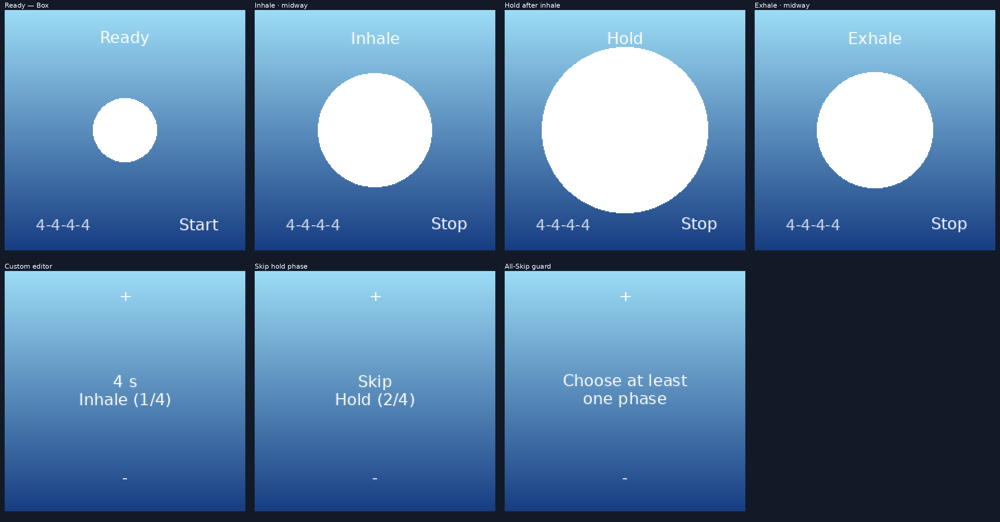

# Roost for PineTime

**A quiet, haptic breathing app for PineTime, built on InfiniTime 1.16.0.**

Roost guides breathing with short vibrations and a simple animated circle.

## Get Roost

**[Download Roost for Infinitime using Gadgetbridge](https://github.com/DizzyDrake/pinetime_infinitime_roost/releases/tag/Roost)** · **[Installation guide](docs/INSTALL_GADGETBRIDGE.md)**

Choose the file ending in **`-DFU.zip`** from Releases. It's a complete InfiniTime firmware update with Roost included.

<p align="center">
  
</p>

<p align="center">
  
</p>

### Features

- Box breathing (4:4:4:4), 4:7:8, and 2:8 presets
- Custom patterns with up to four phases; hold screen to enter/exit custom edit; skip unwanted phases
- Haptic phase cues that continue when the display sleeps
- Incoming calls and watch alarms end a breathing session
- Roost remembers your selected breathing pattern and custom durations between sessions.
- An original launcher icon customized by Aurora

## Add Roost to your own InfiniTime build

The readable Roost source is in [`src/`](src/). A small integration tool handles registration, controller connections, the launcher, and the known InfiniTime 1.16.0 LittleFS logging compatibility fix.

With Python 3 and Git installed, from this repository's root:

```sh
python tools/install_into_infinitime.py --checkout ../InfiniTime-Roost
python tools/build_firmware.py --checkout ../InfiniTime-Roost
```

The first command creates a checkout of InfiniTime 1.16.0 at commit `0fabfe99d9115c5e258a14fd0c985d300ee41f2d` and adds Roost. The second uses Docker and `infinitime/infinitime-build` to compile the full firmware and display the DFU ZIP location and checksum. See [Build from source](docs/BUILD_FROM_SOURCE.md) for details and options.

## Explore the code

Start with [`docs/ARCHITECTURE.md`](docs/ARCHITECTURE.md). The [`annotated source`](docs/annotated-source/src/) adds explanatory comments alongside the runtime C++ without changing its behavior. The original seven development patches are archived in [`history/`](history/) for readers interested in the engineering process.

## Credits and licensing

Roost was designed by **Aurora**, who specified its interactions, original artwork customization, and watch-testing criteria. GPT-6 coded Roost with source integration, implementation, tests, and documentation. The app integrates with the [InfiniTime project](https://github.com/InfiniTimeOrg/InfiniTime) and uses its existing watch APIs.

Original Roost contributions are provided with the Apache-2.0 license in [`LICENSE`](LICENSE). The combined InfiniTime firmware incorporates GPLv3 upstream components. See [`docs/LICENSE_AND_ATTRIBUTION.md`](docs/LICENSE_AND_ATTRIBUTION.md) for details and icon attribution.
